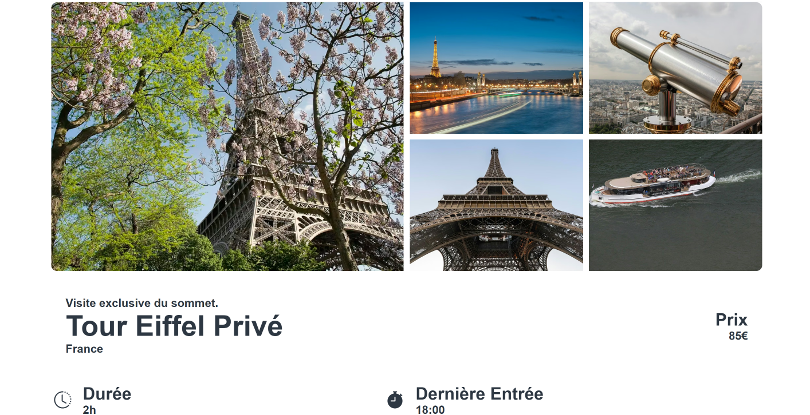

# SAÉ 203 — Site touristique dynamique

Site web réalisé dans le cadre du BUT Métiers du Multimédia
et de l’Internet (MMI), de la conception de la base de données
jusqu’au déploiement.

Le projet permet de découvrir des contenus touristiques,
de parcourir des articles et d’interagir avec les contenus
à travers des formulaires.

**Note obtenue : 20/20**

[Découvrir le site en ligne](https://tayef.alwaysdata.net/SAE203_tayef_abdullahalmasud/)
## Aperçu du site

### Page d’accueil

### Fiche détaillée

### Version mobile

## Technologies

PHP · Twig · SQL · HTML5 · CSS3 · Figma

## Fonctionnalités

- Plus de 30 articles avec textes et images optimisées.
- Consultation des contenus en listes, vignettes et fiches détaillées.
- Navigation et sélections générées à partir de la base de données.
- Formulaires avec validation des données côté serveur.
- Interface responsive pour ordinateur, tablette et mobile.
- Transitions et animations CSS.
- Pages d’erreur personnalisées 403 et 404.

## Conception et réalisation

- Modélisation d’une base de données relationnelle.
- Réalisation de neuf wireframes Figma.
- Développement du back-end avec PHP, SQL et templates Twig.
- Intégration responsive avec prise en compte des recommandations
  d’accessibilité demandées dans le projet.
- Optimisation des images et évaluation avec EcoIndex.
- Déploiement sur les environnements pédagogiques TP2 et Plesk.

## Auteur

Abdullah Al Masud Tayef  
Projet universitaire — SAÉ 203, BUT MMI.
